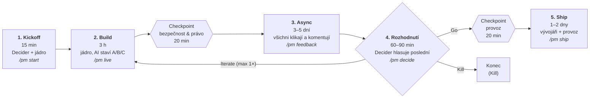

# Postup — Pflanzer Method v jednom obrázku

**Pflanzer Method | pflanzer.cz/method**

> Zjednodušený průběh v0.5 (ADR-0021). Detail: `docs/methodology/00-lean-pflanzer.md`.

## Diagram průběhu

## Kdo kdy

```mermaid
gantt
    dateFormat  D
    axisFormat  den %d
    title Účast v čase (jádro = celou dobu, ostatní jen okna)
    section Jádro (PM, 1–2 vývojáři, designér)
    Kickoff + Build + Rozhodnutí :active, 1, 7d
    section Decider
    Kickoff 15 min      :milestone, 1, 0d
    Rozhodnutí          :milestone, 7, 0d
    section Bezpečnost & právo
    Checkpoint 20 min   :milestone, 2, 0d
    section Provoz
    Checkpoint + Ship   :8, 1d
    section Všichni zástupci
    Async klikání       :3, 4d
```

## Postup v 5 krocích

1. **Kickoff (15 min)** — Decider + jádro. Zadání na 1 stránku: problém
   v 1 větě, metrika úspěchu, kill kritérium. Ke každému ze 6 kroků cesty
   napiš jméno (byznys, produkt, design, vývoj, bezpečnost & právo, provoz).
   Zabookuj okna. *Chybí jméno → nesvolávat.*
2. **Build (3 h)** — jádro u jedné obrazovky. AI staví 3 varianty paralelně.
   Na konci 20 min checkpoint s bezpečností & právem nad datovým tokem.
3. **Async (3–5 dní)** — všichni zástupci klikají na sandbox URL a komentují.
   Vývojář zapracovává.
4. **Rozhodnutí (60–90 min)** — Decider + jádro. 10 min demo, top 3 spory,
   tiché hlasování, Decider poslední → **Go / Iterate / Kill**.
   Iterate = ještě jeden Build, pak už jen Go nebo Kill.
5. **Ship (1–2 dny)** — vývojáři + provoz. Quality gates ≥ 80/100,
   20 min checkpoint provozu, PR do target repa, deploy.

## Tři pravidla

- Každý krok cesty má **jméno**.
- **Max 5 lidí** naráz.
- Co zkontroluje **automat**, nepotřebuje člověka v místnosti.
