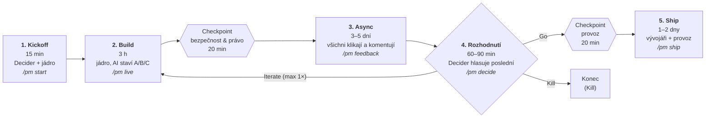
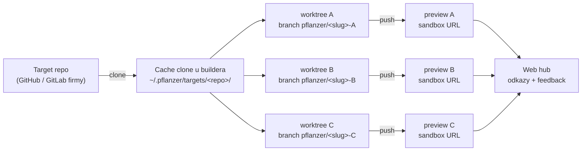

# Postup — Pflanzer Method v jednom obrázku

**Pflanzer Method | pflanzer.cz/method**

> Zjednodušený průběh v0.5 (ADR-0021). Detail: `docs/methodology/00-lean-pflanzer.md`.

## Diagram průběhu

## Kdo kdy

```mermaid
gantt
    dateFormat  D
    axisFormat  den %d
    title Účast v čase (jádro = celou dobu, ostatní jen okna)
    section Jádro (PM, 1–2 vývojáři, designér)
    Kickoff + Build + Rozhodnutí :active, 1, 7d
    section Decider
    Kickoff 15 min      :milestone, 1, 0d
    Rozhodnutí          :milestone, 7, 0d
    section Bezpečnost & právo
    Checkpoint 20 min   :milestone, 2, 0d
    section Provoz
    Checkpoint + Ship   :8, 1d
    section Všichni zástupci
    Async klikání       :3, 4d
```

## Postup v 5 krocích

0. **Před Kickoffem:** `pflanzer doctor` — repo musí být připravené
   (testy, CI, preview deploy, INTEGRATION_GUIDE + CONSTITUTION, pushnuto).
1. **Kickoff (15 min)** — Decider + jádro. Zadání na 1 stránku: problém
   v 1 větě, metrika úspěchu, kill kritérium. Ke každému ze 6 kroků cesty
   napiš jméno (byznys, produkt, design, vývoj, bezpečnost & právo, provoz).
   Zabookuj okna. *Chybí jméno → nesvolávat.*
2. **Build (3 h)** — jádro u jedné obrazovky. AI staví 3 varianty paralelně.
   Kontroly (lint, testy, build) běží průběžně. Checkpoint 20 min
   s bezpečností & právem: datový tok, data classification, egress limit,
   strop tokenů/nákladů, prompt injection; worktree není izolace.
3. **Async (3–5 dní)** — všichni zástupci klikají na sandbox URL a komentují.
   Vývojář zapracovává.
4. **Rozhodnutí (60–90 min)** — Decider + jádro. 10 min demo, top 3 spory,
   tiché hlasování, Decider poslední → **Go / Iterate / Kill**.
   Iterate = ještě jeden Build, pak už jen Go nebo Kill. Otevřený
   critical na vítězi blokuje Go. Decision log jde do repa
   (`.pflanzer/decisions/<slug>.md`).
5. **Ship (1–2 dny)** — vývojáři + provoz. Quality gates jen na vítěze,
   práh pilot 80 / production 85 ze 100,
   20 min checkpoint provozu, PR do target repa, deploy.

## Kde varianty fyzicky jsou

| Kdy | Kód | Běžící varianta | Kdo ji vidí |
|-----|-----|-----------------|-------------|
| **Build** | 3 worktrees na notebooku buildera, každý ve vlastní branchi `pflanzer/<slug>-A/B/C` target repa | lokálně, 3 dev servery na 3 portech (např. `:3001`, `:3002`, `:3003`) | jádro u jedné obrazovky |
| **Async + Rozhodnutí** | branche pushnuté do target repa | **preview deploy každé branche** (bez produkčních dat, noindex, štítek „k rozhodnutí, ne produkt") — 3 URL | všichni zástupci ve svém prohlížeči, bez účtu na prod |
| **Ship** | vítězná branche → PR do `main` target repa; poražené branche se smažou | produkční deploy přes běžnou pipeline | uživatelé |

Prakticky:

- Kód **nikdy nežije mimo target repo** (ADR-0009) — proto vítěz jde
  rovnou do PR, nic se nepřepisuje.
- Sandbox = **to, co firma už má na preview** (Vercel / Netlify preview,
  preview namespace v Kubernetes, review apps v GitLabu). Dohodne se na
  Kickoffu se zástupcem provozu; nic nového se nestaví.
- Odkazy na 3 URL + feedback sbírá web hub (`http://localhost:8000/<slug>`
  nebo sdílená instance). Lidé klikají na URL, ne na notebook buildera.
- Sandbox nesmí vidět produkční data ani síť — to je předmět checkpointu
  bezpečnosti & práva.

> Pozn.: push branchí a preview deploy dnes dělá builder ručně / CI target
> repa; tool (`worktree.py`) zakládá jen worktrees. Automatizace = budoucí
> krok.

Kde jste? `/pm status` — fáze a jeden další krok.

## Tři pravidla

- Každý krok cesty má **jméno**.
- **Max 5 lidí** naráz.
- Co zkontroluje **automat**, nepotřebuje člověka v místnosti.
