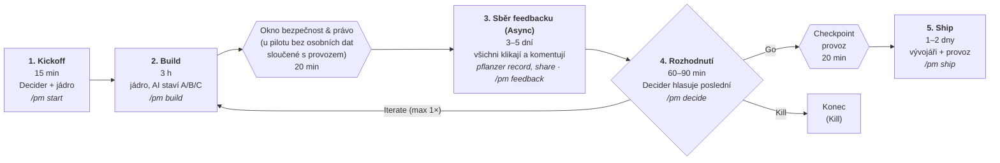
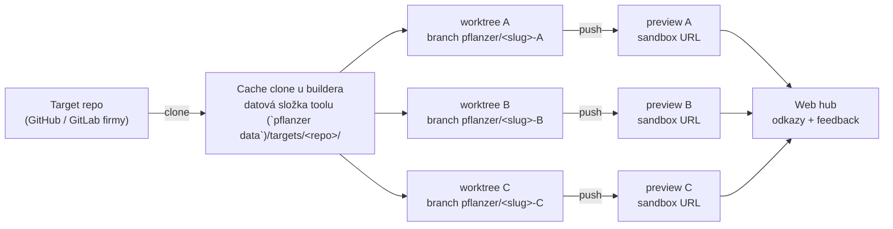

# Postup — Pflanzer Method v jednom obrázku

**Pflanzer Method | pflanzer.cz/method**

> Pro koho: pro každého zástupce, který chce vidět celý průběh na jedné obrazovce.
> Průběh na jednu obrazovku. Detail: [`methodology/00-lean-pflanzer.md`](methodology/00-lean-pflanzer.md).
> Diagram popisuje výchozí stupeň **Lean** (Build 3 h). Kratší je **Quick**
> (`/pm live`, Kickoff + Build v jednom, 60–90 min), delší **Full** pro
> regulované prostředí — viz § Tři stupně v 1-pageru.
> Kolik to stojí a co říct šéfovi: [`zacni.md`](zacni.md#kolik-to-stojí).
> Stupeň a okna se odvodí z jedné otázky v Kickoffu **„Jak vážné to je?“**
> (demo / pilot / ostré + jsou v datech osobní údaje?): demo = žádná okna,
> pilot bez osobních dat = Zadání + jedno okno **Bezpečnost a provoz**,
> s osobními daty Zadání + Bezpečnost & právo + Provoz. Tabulka:
> [`zacni.md`](zacni.md#jak-vážné-to-je).

## Diagram průběhu

## Kdo kdy

## Postup v 5 krocích

0. **Před Kickoffem:** `pflanzer doctor` — repo musí být připravené
   (testy, CI, preview deploy, vyplněný `docs/INTEGRATION_GUIDE.md`
   a `.pflanzer/CONSTITUTION.md`, vše pushnuté).
1. **Kickoff (15 min)** — Decider + jádro. Zadání na 1 stránku: problém
   v 1 větě, metrika úspěchu, kill kritérium. Ke každému ze 6 kroků cesty
   napiš jméno (byznys, produkt, design, vývoj, bezpečnost & právo, provoz).
   Zabookuj okna. *Chybí jméno → nesvolávat.* Kde člověk chybí, může krok
   v omezené míře zastoupit AI (design, předkontrola bezpečnosti a provozu);
   podepisuje vždy člověk — tabulka v [`faq.md`](faq.md#co-když-nemáme).
2. **Build (3 h)** — jádro u jedné obrazovky (online: vývojář sdílí jednu obrazovku, ne 3 breakout místnosti). AI staví 3 varianty paralelně (výchozí; volitelně `mob` = jedna společná varianta u jednoho monitoru, ADR-0016; režim se volí v Kickoffu a drží celou cestu). Po Iterate jdou do druhého kola jen varianty, které pokračují, a sběr feedbacku je kratší (1–2 dny).
   Kontroly (lint, testy, build) běží průběžně. Checkpoint 20 min
   s bezpečností & právem potvrdí tři věci: jaká data AI vidí, kam smí
   síť a kolik smí AI stát (plus riziko podstrčené instrukce v cizím textu).
   Oddělená kopie repa pro variantu není bezpečnostní izolace.
   AI design potvrzuje PdM (`pflanzer checkpoint … design`). Chybí-li
   security, podpis jde v pořadí: člověk z firmy s mandátem → Decider vědomě
   převezme riziko (`--override-triage`) → autor kódu jen jako poslední
   možnost (varování). Podpis s výhradami: `--conditions "CSRF; rate limit"`
   — podmínky skončí v SHIP.md a v checklistu PR.
3. **Sběr feedbacku (Async), 3–5 dní** — builder zapíše hodnocení Buildu
   (`pflanzer record`) a sdílí (`pflanzer share`: varianty i hub na jedné
   adrese, heslo zvlášť; skončí `pflanzer share down`). Všichni zástupci
   proklikají varianty a komentují (hub nebo `pflanzer feedback add --by`);
   hub ukazuje pohled podle role, kdo ještě chybí a termín feedbacku.
   Vývojář zapracovává. Souhrn: `pflanzer feedback_pull`.
4. **Rozhodnutí (60–90 min)** — Decider + jádro. 10 min demo, top 3 spory,
   tiché hlasování (informativní, rozhoduje Decider), Decider poslední →
   **Go / Iterate / Kill** (`pflanzer decide`, před ním `decide prep`).
   Iterate (s výběrem variant `--variants A,B`) = ještě jeden Build, pak už jen Go nebo Kill. Po Kill tool vypíše úklid (náhled, worktrees). Otevřená
   Kritická připomínka (`critical`) na vítězi blokuje Go. Decision log jde do repa
   (`.pflanzer/decisions/<slug>.md`).
5. **Ship (1–2 dny)** — vývojáři + provoz. Quality gates jen na vítěze,
   práh pilot 80 / production 85 ze 100 (throwaway: skóre informativně,
   Ship neblokuje; skóre je věta „Skóre X ze 100 z N automatických kontrol“,
   částečné, když část kontrol neproběhla, a neměří splnění zadání),
   `pflanzer ship` sám vyrobí `SHIP.md` a text PR a vypíše `gh pr create`,
   20 min checkpoint provozu (rollback, kdo je na telefonu, první hodina),
   PR do repa produktu, deploy. U pilotu a production blokuje Ship
   nepodepsané okno (u Lean podpisy oken nahrazují plný triage; ten běží
   jen u stupně Full). Výhrady z podpisů (`--conditions`) jdou do SHIP.md
   a checklistu PR.

## Kde varianty fyzicky jsou

| Kdy | Kód | Běžící varianta | Kdo ji vidí |
|-----|-----|-----------------|-------------|
| **Build** | 3 oddělené kopie repa (worktrees) na notebooku buildera, každý ve vlastní branchi `pflanzer/<slug>-A/B/C` target repa | lokálně, 3 dev servery na 3 portech (např. `:3001`, `:3002`, `:3003`) | jádro u jedné obrazovky |
| **Sběr feedbacku + Rozhodnutí** | branche pushnuté do target repa | **preview deploy každé branche** (bez produkčních dat, noindex, štítek „k rozhodnutí, ne produkt") — 3 URL | všichni zástupci ve svém prohlížeči, bez účtu na prod |
| **Ship** | vítězná branche → PR do `main` target repa; poražené branche se smažou | produkční deploy přes běžnou pipeline | uživatelé |

Prakticky:

- Větve `pflanzer/<slug>-A/B/C` jsou v klonu target repa pod
  `data/targets/<slug>-<X>` (ne v hlavním repu) — pushuje se odtamtud:
  `cd data/targets/<slug>-A && git push origin pflanzer/<slug>-A`.
- Kód **nikdy nežije mimo repo produktu** — proto vítěz jde rovnou do PR,
  nic se nepřepisuje.
- Sandbox = **to, co firma už má na preview** (Vercel / Netlify preview,
  preview namespace v Kubernetes, review apps v GitLabu). Dohodne se na
  Kickoffu se zástupcem provozu; nic nového se nestaví.
- Odkazy na 3 URL + feedback sbírá web hub — `pflanzer share --slug S` po `pflanzer record` (jedna adresa + heslo; detaily `preview` a `hub` ve [`faq.md`](faq.md#tunel-lan-a-preview)), nebo offline `pflanzer feedback add`. Lidé klikají na URL, ne na notebook buildera.
- Sandbox nesmí vidět produkční data ani síť — to je předmět checkpointu
  bezpečnosti & práva.

**Možnosti, jak varianty zpřístupnit** (od nejjednoduššího):

1. **Lokální preview s heslem** — `pflanzer share --slug <slug>` (pod ním
   `pflanzer preview up --slug <slug>`) spustí aplikaci z worktrees A/B/C, před každou postaví malý proxy s heslem
   (libovolné uživatelské jméno, rozhoduje heslo) a štítkem „Varianta X k rozhodnutí — není to hotový
   produkt“ a vypíše 3 URL + hotovou zprávu zástupcům. S `cloudflared` v PATH
   (`--tunnel auto`) dostane každá varianta veřejnou `https://*.trycloudflare.com`
   URL, jinak jen lokální / LAN (`--host 0.0.0.0`). Kód nikam neodchází; provoz
   přes tunel ale jde přes Cloudflare (zapsat na checkpointu bezpečnosti).
   Příkaz aplikace: `.pflanzer/project.toml` → `[preview] command = "… {port}"`,
   jinak autodetekce (`npm run dev`/`npm start`, `make run`, `python -m`).
   Počítač buildera musí běžet po dobu sběru feedbacku; `pflanzer preview status|down`
   (hub a varianty naráz zastaví `pflanzer share down`).
   Vhodné, když interní GitHub nejde napojit na Vercel a kód nemá opustit firmu.
2. **Preview deploy firmy** — push branchí, preview URL z CI (výše). Vercel
   a podobné jsou volitelné, ne default.
3. **Draft PR per varianta** — `pflanzer worktree preview --slug <slug>`
   založí draft PR každé větve; preview URL se vezme z checků PR (Vercel /
   Netlify) a uloží k variantě. Push do remote target repa tool nejdřív
   vypíše a chce potvrzení.
4. **Playwright záznam** — `pflanzer worktree preview --slug <slug> --mode playwright`
   nahraje průchod acceptance scénáři (video + trace); pro zástupce, kteří
   nemají kde klikat, nebo když firma preview deploy nemá.

Push branchí a preview deploy jinak dělá builder / CI target repa; tool
zakládá worktrees a (volitelně) draft PR.

Kde jste? `/pm status` — fáze a jeden další krok.

## Tři pravidla

- Každý krok cesty má **jméno**.
- **Max 5 lidí** naráz.
- Co zkontroluje **automat**, nepotřebuje člověka v místnosti.
